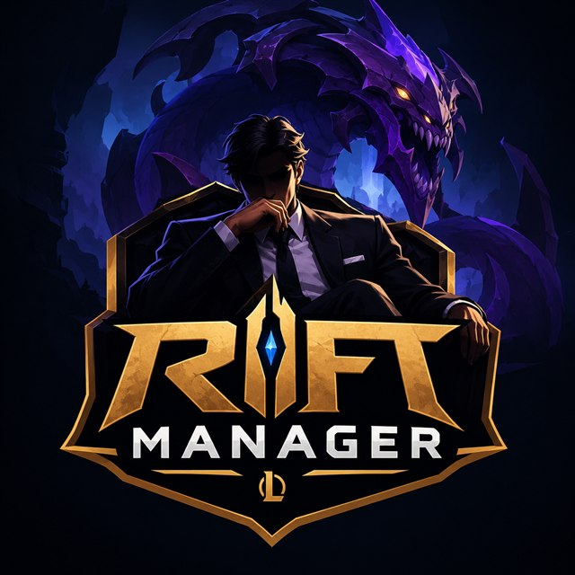

<p align="center">
  
</p>

# Rift Manager

Jogo de gerenciamento de esports em que você é o **coach** de um time de League of Legends. Protótipo de fã, sem fins comerciais.

## Como rodar

```bash
npm install
npm run dev
```

Depois, abra http://localhost:5173 no navegador.

## O que dá para fazer

- **Carreira:** crie seu coach (nome, país, estilo) e comece na 2ª divisão da liga escolhida (CBLOL → Circuito Desafiante, LCK → LCK Challengers…). Bons resultados trazem propostas de times maiores.
- **Temporada completa:** Copas (Split 1), First Stand, Split 2, MSI, Esports World Cup, Split 3, Worlds e mercado.
- **Treino semanal:** escolha o foco das scrims e a intensidade.
- **Draft:** pick e ban no estilo das transmissões, com Fearless Draft e meta por patch.
- **Partida ao vivo:** acompanhe o jogo lance a lance.
- **Gestão:** escalação, táticas, mercado de transferências, staff, finanças e eventos de bastidores.
- **Histórico:** perfil dos jogadores com estatísticas e a galeria de campeões.

## Dados

- Times, jogadores e ligas vêm da API do [lolesports.com](https://lolesports.com). Para atualizar, rode `npm run import`; para regerar a partir dos arquivos já baixados em `data-raw/`, use `npm run import:offline`.
- Campeões e imagens vêm do [Data Dragon](https://developer.riotgames.com/docs/lol#data-dragon) da Riot e do [Community Dragon](https://communitydragon.org).
- Os atributos dos jogadores são gerados pelo jogo e não refletem números oficiais.

## Tecnologia

React, TypeScript e Vite. O progresso fica salvo no próprio navegador (IndexedDB).

---

Rift Manager não é endossado pela Riot Games e não reflete as opiniões da Riot Games ou de qualquer pessoa oficialmente envolvida na produção ou gestão de League of Legends. League of Legends e Riot Games são marcas registradas da Riot Games, Inc.
